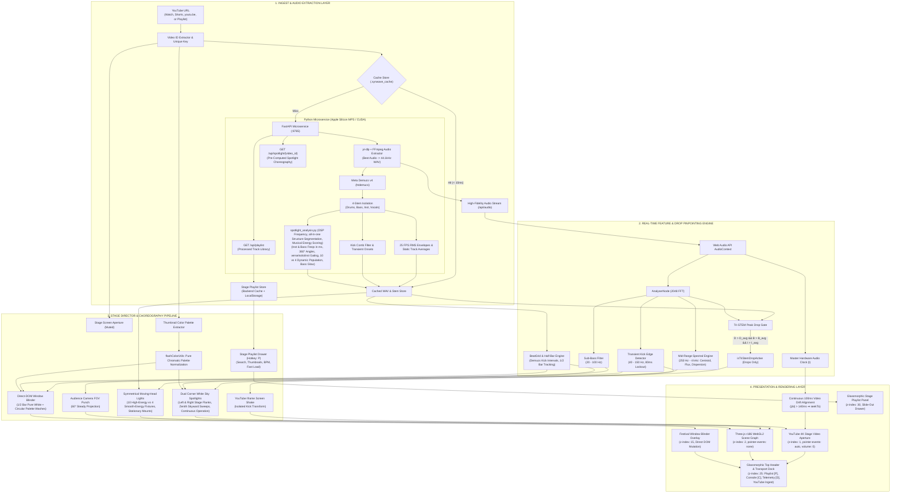

<div align="center">

  

  # SYNWAVE

  **Autonomous Procedural 3D Concert Stage Simulator & Neural Music Visualizer**

  [](LICENSE)
  [](https://vitejs.dev/)
  [](https://react.dev/)
  [](https://threejs.org/)
  [](https://pytorch.org/)
  [](https://www.typescriptlang.org/)
  [](https://fastapi.tiangolo.com/)

  <p align="center">
    A stadium-scale music festival concert simulator that orchestrates real-time, procedural 3D audiovisual performances. Powered by direct YouTube link ingest, high-fidelity audio extraction via <code>yt-dlp</code> and <code>ffmpeg</code>, Meta Demucs v4 neural 4-stem source separation on Apple Silicon Metal Performance Shaders (MPS), synchronized stage video playback, and intelligent concert lighting choreography.
  </p>

</div>

---

> [!WARNING]
> ### ⚠️ Photosensitivity & Flashing Lights Warning
> **Synwave contains intense flashing lights, high-contrast strobe blinders, and rapid color oscillations that may trigger discomfort or seizures for individuals with photosensitive epilepsy or light sensitivities.**
> 
> - If you are sensitive to flashing lights, enable **Reduced Flash Mode** by pressing the `M` key or toggling it inside the **Routing Console (`C`)**.
> - Viewer discretion is strongly advised.

> [!CAUTION]
> ### 🥁 Music Compatibility Notice: Do Not Use on Songs Without Beats
> **Synwave is engineered specifically for rhythmically driven music (EDM, house, dubstep, rock, hip-hop, trap, synthwave, electronic, and high-tempo pop) with clear drum kicks, basslines, and percussive transients.**
> 
> **Do NOT use on songs without beats (such as sad acoustic songs, ambient soundscapes, classical solo piano, or percussion-free ballads).** The procedural lighting directors, kick deflection mechanisms, and drop pinpointers rely on percussive drum transients and neural kick envelopes; running beatless tracks will result in inert or misaligned lighting choreographies.

---

## 🎬 Live Demo Preview

<div align="center">
  <video src="https://github.com/user-attachments/assets/2b475ec5-99e2-4cbe-8975-9841f29ee006" width="100%" controls="controls" poster="demo/poster.png" style="max-width: 960px; border-radius: 14px; box-shadow: 0 10px 40px rgba(0, 0, 0, 0.55);"></video>
</div>

https://github.com/user-attachments/assets/2b475ec5-99e2-4cbe-8975-9841f29ee006

> [!NOTE]
> ### 🎵 Music & Visual Attribution
> **Audio & Visual Demo Showcase:**  
> - **Song & Music Video:** [Abandoned - Destroyer Of Worlds (Oppenheimer Remix) [Music Video]](https://www.youtube.com/@AbandonedOfficial)  
> - **Creator / Channel:** [Abandoned (@AbandonedOfficial)](https://www.youtube.com/@AbandonedOfficial)  
> - *Full music and visual credit to **Abandoned** for the audio composition and official music video featured in this demonstration.*

---

> [!IMPORTANT]
> ### 💬 Note to Potential Contributors & Community
> **Synwave is an evolving open-source project, and I know it still has bugs and areas that need improvement. Contributions, bug reports, suggestions, and pull requests are very welcome. Help me fix the existing issues and turn Synwave into a polished, reliable product!**

---

## 📑 Table of Contents

- [🎬 Live Demo Preview](#-live-demo-preview)
- [🌟 Project Overview](#-project-overview)
- [🏗️ Architectural Block Diagram](#️-architectural-block-diagram)
  - [System Flow Diagram (Mermaid)](#system-flow-diagram-mermaid)
  - [Functional Block Topology (ASCII)](#functional-block-topology-ascii)
  - [Deep Architectural Walkthrough](#deep-architectural-walkthrough)
- [✨ Key Features](#-key-features)
- [🎛️ Audio-to-Visual Routing Console Specification](#️-audio-to-visual-routing-console-specification)
- [⌨️ Controls & Keyboard Shortcuts](#-controls--keyboard-shortcuts)
- [🚀 Installation & Development Setup](#-installation--development-setup)
- [🛠️ Technologies & Official Repositories](#️-technologies--official-repositories)
- [📜 Third-Party Libraries, Licenses & Attribution](#-third-party-libraries-licenses--attribution)
- [🐛 Known Issues & Roadmap](#-known-issues--roadmap)
- [🤝 How to Contribute](#-how-to-contribute)
  - [🌟 Call for Contributors: Lasers & Stage Elements](#-call-for-contributors-lasers--stage-elements)
  - [Contribution Workflow](#contribution-workflow)
- [📄 License](#-license)

---

## 🌟 Project Overview

**Synwave** transforms any YouTube link into a stadium-scale **procedural concert experience**. Rather than drawing simple 2D FFT spectrogram bars or unanchored wandering particles, Synwave acts as an **autonomous concert lighting designer and stage director**.

It places the user in the **front-row audience** facing a colossal festival stage modeled after real-world arena spectacles (Ultra Music Festival, Tomorrowland, EDC).

When a YouTube link is submitted, Synwave executes an acoustic intelligence pipeline:
1. **Direct YouTube Stage Video Mounting:** Loads and displays the YouTube video on the stage aperture screen with audio muted (`volume = 0`).
2. **High-Fidelity Audio Extraction (`yt-dlp` & `ffmpeg`):** Downloads and converts the uncompressed high-fidelity audio stream to WAV on the local microservice.
3. **Neural Source Separation (Meta Demucs v4):** Isolates the audio into 4 discrete acoustic stems (`drums`, `bass`, `instruments`, `vocals`) accelerated by Apple Silicon MPS hardware.
4. **Tri-STEM Peak Drop Pinpointing:** Identifies the precise climactic segments where drums, bass, and instruments simultaneously exceed their track averages.
5. **Procedural 3D Stage Choreography:** Directs moving-head spotlights, dual corner sky-reaching white searchlights, a 360° perimeter bass rig, camera sub-bass FOV zooms, and vertical-sync full-window blinder washes.
6. **Sub-10ms Persistent Cache:** Stores extracted audio and separated stem envelopes under `.synwave_cache` keyed uniquely by the YouTube link.

---

## 🏗️ Architectural Block Diagram

Synwave is structured into a four-tier decoupled architecture separating acoustic intelligence, real-time audio analysis, stage choreography, and hardware-accelerated presentation.

### System Flow Diagram (Mermaid)



---

### Functional Block Topology (ASCII)

```
====================================================================================================
                                      SYNWAVE SYSTEM TOPOLOGY
====================================================================================================

 [ YouTube URL / Stage Playlist / Instant Switch ] ──► [ Video ID & Cache Resolver ]
                                                             │
               ┌─────────────────────────────────────────────┴────────────────────────────┐
               ▼ (Cache Hit < 10ms)                                                       ▼ (Cache Miss)
    [ Persistent Cache Store ]                                                  [ FastAPI Daemon (:8765) ]
    • Tier 1: In-Memory Map                                                     • Direct Audio Stream via yt-dlp & FFmpeg
    • Tier 2: Browser LocalStorage                                              • Meta Demucs v4 (htdemucs on MPS)
    • Tier 3: Local Disk (.synwave_cache)                                       • mir-aidj/all-in-one Structure Segmentation
    • Tier 4: GET /api/playlist                                                 • Multi-Feature Acoustic Energy Scoring
               │                                                                          │
               └─────────────────────────────────────────────┬────────────────────────────┘
                                                             │
                                                             ▼
                                            [ Real-Time Audio Engine ]
                                            • Web Audio API Master Clock (t)
                                            • 2048-Point FFT Spectral Decomp
                                            • Tri-STEM Peak Drop Activation:
                                              (D > D_avg) ∧ (B > B_avg) ∧ (I > I_avg) ∧ (Joint ≥ Thresh)
                                                             │
        ┌────────────────────────────────────────────────────┼────────────────────────────────────┐
        ▼                                                    ▼                                    ▼
 [ Sub-Bass (20-100Hz) ]                          [ Kick Transient (40-150Hz) ]        [ Mid-Range Spectral (250Hz-4kHz) ]
   Locked 60° FOV Camera                            Screen Shake & Blinder Trigger       White Sky Searchlights & Moving Heads
        │                                                    │                                    │
        └────────────────────────────────────────────────────┼────────────────────────────────────┘
                                                             │
                                                             ▼
                                            [ Show Director & Visual Engine ]
                                            • Dynamic Symmetrical Fixtures (10 High Energy vs 4 Smooth Energy)
                                            • Explicit Section Gating (Active strictly during verse, solo, inst)
                                            • Double-Sided Volumetric Cones with Beam Brightness Slider (50% - 300%)
                                            • Dual Corner White Sky Searchlights (Continuous Operation & Kick Surges)
                                            • Full-Window Blinder Wash (1/2 Bar White Anchor + Pure Palette Colors)
                                            • Atomic Stage State Purge & Seamless In-Place YouTube Video Switching
                                                             │
       ┌─────────────────────────────────────────────────────┴────────────────────────────────────┐
       ▼                                                                                          ▼
[ Three.js r186 Scene Graph ]                                                  [ YouTube 4K Stage Screen ]
• Transparent WebGL2 Canvas (z: 2)                                             • 16:9 Stage Aperture (z: 1)
• 10 Symmetrical Stationary Moving Heads + 2 White Sky Beams                   • Muted Video Playback (vol: 0)
• Stage Truss & Jumbotron Bezels                                               • Seamless In-Place Iframe Teardown
• Stage Playlist Drawer (z: 30)                                                • Zero Synwave Text Overlays
====================================================================================================
```

---

### Deep Architectural Walkthrough

#### 1. Acoustic Intelligence & Multi-Tier Caching Layer
- **Direct YouTube URL Audio Ingestion:** Provide any YouTube URL (or select from the persistent playlist). The Python microservice automatically downloads and extracts the uncompressed high-fidelity audio stream to WAV via `yt-dlp` and `ffmpeg` without requiring any external API keys or credentials.
- **Meta Demucs v4 HTDemucs (`demucs_service.py`):** Isolates local audio into four discrete high-fidelity stems: `drums`, `bass`, `instruments`, and `vocals`. Running on Apple Silicon Metal Performance Shaders (MPS) or NVIDIA CUDA, it computes 25 FPS normalized RMS envelopes, static track-wide averages ($\bar{A}_D, \bar{A}_B, \bar{A}_I$), and transient kick onsets.
- **Persistent Multi-Tier Stem Cache (`.synwave_cache/`):**
  - **In-Memory & IndexedDB:** Instant zero-latency lookups for active session tracks.
  - **Local Disk Cache:** Pre-processed WAV audio (`.synwave_cache/audio/yt_*.wav`), neural stem JSON envelopes (`.synwave_cache/stems/`), and metadata (`.synwave_cache/metadata/`). Pre-analyzed tracks achieve a `< 20ms` sub-millisecond cache hit, loading instantaneously.
  - **Stage Playlist Ingestion API (`/api/playlist`):** Automatically aggregates all processed tracks, their YouTube video IDs, durations, extracted thumbnails, Demucs neural stem readiness, and BPMs into a single responsive library.

#### 2. Real-Time Feature & Drop Pinpointing Engine
- **Pinpointed Tri-STEM Peak Drop Gate (`AudioEngine.ts`):** Climactic visuals and drop sweeps are gated strictly by the song's true drop segment. A frame qualifies as a drop if and only if:
  $$D(t) > \bar{A}_D \;\land\; B(t) > \bar{A}_B \;\land\; I(t) > \bar{A}_I \;\land\; J(t) \ge \text{Threshold}$$
  This mathematical gate completely eliminates false activations during vocal buildups, quiet intros, and acoustic breakdowns.
- **Isolated Sub-Bass Bandpass ($20-100\text{Hz}$):** Directly drives camera FOV zoom punch ($60^\circ \to 63.5^\circ$), physically vibrating the audience perspective without harmonic distortion from vocals or guitars.
- **Transient Kick Detection ($40-150\text{Hz}$):** Comb-filtered kick detector fusing Demucs neural kick transients with FFT kick spikes across an 80ms refractory lockout, driving 2D pixel displacement strictly on the YouTube stage screen element.
- **Mid-Range Spectral Engine ($250\text{Hz}-4\text{kHz}$):** Computes mid-range spectral centroid ($C_{\text{mid}}$), spectral flux ($F_{\text{mid}}$), and dispersion ($D_{\text{mid}}$) fused with Demucs instrumental data to steer intelligent concert spotlight choreographies without bass interference.

#### 3. Stage Director & Visual Choreography Pipeline
- **Stationary Spotlight Fixtures & Attachment Architecture:**
  - All spotlight fixtures behave like physical, stationary concert lights mounted permanently around the festival stage (Top box-truss, Left tower, Right tower, and bottom stage corners).
  - Fixture origins (`basePos`, `fixedBaseMesh.position`, `headGroup.position`) remain **strictly fixed in 3D space** throughout playback. Zero physical translation or lerping of fixture mount origins.
  - Camera FOV is **permanently locked at 60.0°** (`camera.fov = 60`), completely eliminating unwanted scene zoom-in/zoom-out effects on sub-bass or kicks.
  - Strict decoupling of Fixture Transforms (fixed origins/orientations), Beam Transforms (audio-reactive trajectories), Glow Controls (continuous intensity factor), and Iframe Shake (isolated strictly to the YouTube video element).
- **10 Full-Screen Movement Path Families (`SpotlightMovementController.ts`):**
  - Replaces restrictive central "X" criss-crossing with coordinated paths traversing the **entire visualization viewport** ($X \in [-20, 20]$, $Y \in [0.5, 15.0]$, $Z \in [12.5, 15.5]$), visibly reaching far outside all four sides of the iframe:
    1. `wide-horizontal`: Horizontal sweeps traversing across the complete viewport from far left to far right.
    2. `wide-vertical`: Vertical sweeps traversing through the upper and lower screen regions.
    3. `perimeter`: Sweeps traveling around the outer perimeter of the visualization, framing the stage.
    4. `diagonal`: Traverses diagonally with varied directions and crossing locations.
    5. `arc-fan`: Broad curved fan-shaped sweeps radiating outward across the arena.
    6. `outer-to-inner`: Sweeps starting from outer stadium periphery inward toward intermediate framing.
    7. `inner-to-outer`: Travels outward from the stage toward the far screen edges.
    8. `circular-elliptical`: Broad elliptical trajectories surrounding the visualization.
    9. `asymmetric`: Left and right groups cover distinct independent regions without forming a mirrored X.
    10. `slow-cinematic`: Gradual, broad, majestic sweeps tailored for solos and calmer passages.
  - Unified movement controller smoothly transitions between paths over 1.6s with smoothstep interpolation based on musical context (solos favor cinematic/arc-fan sweeps; verses cycle through dynamic wide sweeps).
- **Synchronized Spotlight Groups:**
  - **Left-Side Group:** All left-side spotlights move in synchronization with each other, driven by the continuous instrument-frequency angular reference $\theta(t) = 360^\circ \cdot f_{\text{norm}}(t)$ with individual fixture geometric offsets.
  - **Right-Side Group:** All right-side spotlights move in synchronization with each other, governed by the opposite angular reference $\theta_R(t) = \text{wrap}_{360}(-\theta(t) + \theta_{R0})$ with spatial elevation/lateral offsets, completely preventing central "X" beam collisions.
  - **Top-Side Group:** All top-side spotlights move in synchronization along the overhead box-truss.
  - **Two White Bottom Spotlights:** Two corner searchlights projecting broad skyward trajectories across the viewport. They **never change beam direction on kick events**.
- **Dynamic Symmetrical Spotlight Population (10 vs 4 Fixtures):**
  - **Physical Rig (10 Primary + 2 White Sky Searchlights):**
    - **Top Overhead Truss (4 Fixtures):** Mounted at $Y = Y_{\text{top}} + 1.25, Z = Z_{\text{screen}} + 0.5$ at symmetrical X-offsets $\pm 0.22 W$ and $\pm 0.65 W$ (Indices `[0, 1, 2, 3]`).
    - **Left Vertical Tower (3 Fixtures):** Mounted at $X = X_{\text{left}} - 1.55$ spanning Upper ($Y_{\text{center}} + 0.65 H$), Middle ($Y_{\text{center}}$), and Lower ($Y_{\text{center}} - 0.65 H$) (Indices `[4, 5, 6]`).
    - **Right Vertical Tower (3 Fixtures):** Mounted symmetrically at $X = X_{\text{right}} + 1.55$ spanning Upper, Middle, and Lower (Indices `[7, 8, 9]`).
    - **Corner White Sky Searchlights (2 Fixtures):** Bottom-left and bottom-right corners, operating independently outside the 10-primary count.
  - **Symmetrical Subset Selection:**
    - **High-Energy Tracks (10 Spotlights):** Enables all 10 fixtures (`[0, 1, 2, 3, 4, 5, 6, 7, 8, 9]`).
    - **Smooth / Low-Energy Tracks (4 Spotlights):** Symmetrically enables 4 fixtures (`[1, 2, 5, 8]`: top inner pair and middle fixtures on left/right towers).
  - **Multi-Feature Acoustic Energy Scoring:**
    $$S = 0.35 \cdot \min\left(1.0, \frac{D_{\text{kick}}}{1.75}\right) + 0.25 \cdot \min\left(1.0, \frac{R_{\text{drum}}}{0.32}\right) + 0.15 \cdot \min\left(1.0, \frac{C_{\text{active}}}{0.55}\right) + 0.15 \cdot \min\left(1.0, \frac{I_{\text{rms}}}{0.14}\right) + 0.10 \cdot \min\left(1.0, \frac{B_{\text{rms}}}{0.16}\right)$$
    Tracks are classified as High-Energy ($10\text{ fixtures}$) if $S \ge 0.46 \lor (D_{\text{kick}} \ge 0.95 \land R_{\text{drum}} \ge 0.18) \lor D_{\text{kick}} \ge 1.25$; otherwise Smooth ($4\text{ fixtures}$).
- **Section-Based Activation Policy (`verse`, `solo`, `inst`):**
  - Uses `mir-aidj/all-in-one` structural classification with direct stem inputs to segment songs into functional blocks.
  - Multi-class classification pipeline identifies:
    - Verses (`verse`): confidence $\ge 0.95$.
    - Instrumental Solos (`instrumental_solo`): confidence $0.88-0.92$.
    - Lead-Instrument Solos (`lead_instrument_solo`): confidence $0.92$.
    - Vocal Solos (`vocal_solo`): confidence $0.90$.
    - Instrumental Passages (`inst` / `instrumental`): confidence $0.92$.
    - Inactive sections (`chorus`, `intro`, `outro`, `break`, `bridge`, `start`, `end`).
  - **Activation Policy:** Primary coloured spotlights illuminate with smooth attack/release fades ($0.3\text{s}$) strictly during sections labeled `verse`, `solo`, or `inst`. Outside eligible sections, coloured spotlight beams remain cleanly off; kick transients outside eligible sections do NOT reactivate coloured spotlights.
- **Volumetric Beam Radiance & In-App Brightness Calibration:**
  - **Double-Sided Volumetric Cones (`THREE.DoubleSide`):** Renders volumetric beam geometries with physical depth and high luminous transmittance across both dark arena backgrounds and live video.
  - **Luminance Formulation:**
    $$\text{opacity}_{\text{coloured}} = \min\left(0.92, \; 0.44 \cdot \text{maxBri} \cdot \text{intensity} \cdot \text{beamBri}\right)$$
    $$\text{opacity}_{\text{white}} = \min\left(0.95, \; 0.52 \cdot \text{maxBri} \cdot \text{whiteGlow} \cdot \text{beamBri}\right)$$
  - **Spotlight Beam Brightness Slider (`RoutingConsole.tsx`):** Dedicated slider in Section 5 of the Audio-to-Visual Routing Console (`C`) providing interactive calibration from $50\%$ to $300\%$ (default $150\%$) with real-time percentage feedback.
  - **Stage Wash Coupling:** Moving-head point lights scale proportionally with beam brightness, casting radiant chromatic wash across the stage deck and truss rig.
- **Initial Off-State & Seamless In-Place YouTube Video Switching:**
  - **Initial Off-State:** Merely loading or pasting a YouTube video leaves all fixtures completely dark (opacity 0.0), including both primary coloured spotlights and white searchlights. Spotlights only activate once media playback begins and authoritatively enters an eligible section.
  - **Seamless Switching Without Refresh:** Switch between any YouTube links directly in the top navigation pill without page reloads. Instantly tears down existing `YT.Player` instances, clears neural stem caches and kick-event buffers, resets screen shake impulses, recenters the iframe, and isolates lighting envelopes so no state leaks between songs.
- **Kick-Synchronized Direction Changes & White Spotlight Glow:**
  - On valid kick events during verses/solos/inst, active main coloured spotlights deflect smoothly to precomputed deterministic 3D targets across the full viewport (attack $35\text{ms}$, hold $40\text{ms}$, decay $180\text{ms}$) before resuming ongoing trajectories.
  - Two white bottom spotlights respond to kicks through **glow intensity only** (+1.8 to +2.8x surge), decaying smoothly back to ongoing bass glow. Beam directions never change.
- **Continuous Frequency-Driven Glow Factor ($0.0 \to 1.0$):**
  - Continuous Bass STEM frequency drives continuous glow intensity:
    $$G(t) = \text{clamp}\left(\frac{f_{\text{bass}}(t) - f_{\min}}{f_{\max} - f_{\min}}, 0, 1\right)$$
  - Blended with base glow ($0.15$), kick glow surges, and activation envelope.
- **Kick-Activated Screen Flash Blinder (`flashColorUtils.ts` & `VisualEngine.ts`):**
  - **Pure Color Gradient Isolation:** Full-window radial blinder wash ($100\text{vw} \times 100\text{vh}$ at `z-index: 15`). White frames flash pure brilliant white; colored frames flash 100% pure RGB values from the song palette without central white core washout.
  - **1/2 Bar Pure White Anchor Rule:** Every 1/2 bar downbeat kick (every 2 beats in 4/4 meter) flashes pure white (`#ffffff`), anchoring the rhythmic structure.
  - **Circular Palette Color Rotation:** Additional kicks occurring within the same 1/2 bar cycle through the extracted song palette one after another in a continuous circular sequence.
  - **Zero Dropped Kicks:** Evaluated with an 80ms refractory interval that supports ultra-fast drum rolls up to 750 BPM with no minimum volume dropouts.
- **Isolated YouTube Iframe Kick Shake:**
  - Percussive drum kicks drive a distinct 2D screen shake **strictly isolated to the DOM YouTube stage video iframe element** (`#synwave-youtube-stage-screen`) via `style.transform = translate(calc(-50% + ${dx}px), calc(-50% + ${dy}px))`.
  - The complete spotlight assembly, canvas, fixture origins, and blinder do NOT shake.
  - Returns exactly to `translate(-50%, -50%)` after every shake.
  - Independent of spotlight activation: iframe shakes on kicks across all song sections.

#### 4. Presentation & Hardware-Accelerated Rendering Layer
- **Three.js r186 WebGL2 Canvas (`z-index: 2`):** Transparent canvas overlaying the stage video with additive volumetric lighting, stage trusses, moving heads, and atmosphere dust.
- **Synchronized 1K YouTube Stage Aperture (`z-index: 1`):**
  - Muted video playback (`volume = 0`) complying with browser autoplay policies while local lossless audio serves as the master clock.
  - Continuous 100ms drift monitor: if video drifts $> 140\text{ms}$ from master audio, micro-seeks snap the playhead back into phase.
  - **Highest Resolution till 1K (`hd1080` / `hd720`):** Enforces 1080p Full HD video playback via `vq: 'hd1080'` and proactive quality negotiations on buffer and playback starts, capping out $> 1\text{K}$ streams to preserve 60 FPS stage performance.
  - **Centered 16:9 Caption-Masking Crop:** Scaled uniformly at $1.40\times$ from the center within an `overflow: hidden` aperture. Eliminates bottom closed captions, roll-up auto-subtitles, and player watermarks while maintaining a non-distorted, standard 16:9 aspect ratio without over-cropping the concert performance.
  - Clean video aperture: zero Synwave-generated text overlays, badges, or titles over the video; captions disabled by default (`cc_load_policy: 0`, `controls: 0`).
- **Responsive Glassmorphic HUD & Stage Playlist Drawer (`z-index: 25` & `z-index: 30`):**
  - **Stage Playlist Drawer (`P`):** Slide-out drawer with real-time title/artist search, 16:9 YouTube thumbnail previews, 3-bar animated soundwave equalizer for active tracks, `STEMS READY` / `BPM` badges, and instant single-click song loading.
  - **Audio-to-Visual Routing Console (`C`):** Full real-time calibration of spotlight beam brightness (50%–300%), active fixture counts, shake, blinders, decay, and photosensitive safety mode.
  - **Real-Time Telemetry HUD (`D`):** Live FFT, neural stem meters, BPM confidence, and MPS hardware diagnostics.

---

## ✨ Key Features

- **Dynamic Symmetrical Spotlight Population (10 vs 4 Fixtures):**
  Synwave automatically gauges the track's musical energy through pre-analysis across kick transient density, drum stem ratio, active temporal coverage, and instrumental intensity:
  - **High-Energy Tracks:** Activates all 10 primary concert moving heads (4 along top overhead truss, 3 along left vertical tower, 3 along right vertical tower).
  - **Smooth / Low-Energy Tracks:** Symmetrically activates 4 primary moving heads (inner pair flanking the iframe center at top, and middle fixtures on left and right vertical towers).
  - Fixture mounting origins remain stationary and geometrically balanced across all viewport sizes.
- **Section-Based Spotlight Activation (`verse`, `solo`, `inst`):**
  Uses `mir-aidj/all-in-one` structural classification with direct stem inputs to segment songs into functional blocks. Primary coloured spotlights illuminate with smooth attack/release fades ($0.3\text{s}$) exclusively during sections labeled `verse`, `solo`, or `inst` (instrumental passages). Outside eligible sections, coloured spotlight beams remain cleanly off; kick transients outside eligible sections never reactivate coloured spotlights.
- **Dedicated White Bottom Sky Searchlights:**
  Two bottom corner searchlights operate independently outside the 10-primary count. They remain enabled continuously once playback begins, projecting upward into the arena sky and surging dynamically in glow (+1.8 to +2.8x) on kick transient beats without changing beam direction.
- **Initial Loading State (All Spotlights Off):**
  Merely loading or selecting a video leaves all spotlights completely dark (opacity 0.0), including both primary coloured fixtures and the white searchlights. Spotlights only activate once media playback begins and authoritatively enters an eligible section.
- **Seamless In-Place YouTube Video Switching:**
  Switch between any YouTube videos directly in the top navigation bar without refreshing the page or restarting the app. Immediately cleans up previous player instances, purges previous audio analysis, resets kick-event tracking, centers the iframe, and isolates lighting envelopes so no state leaks between songs.
- **STEM Frequency Pre-Analysis & 360° Spotlight Choreography:**
  Offline pre-analysis computes continuous timestamped frequencies for both the Instrument and Bass STEMs. Instrument frequency is linearly mapped to a 360° reference angle directing coordinated full-screen beam trajectories across 10 distinct path families.
- **Continuous Bass Glow Factor ($0.0 \to 1.0$):**
  Spotlight glowing factor is continuously driven by the normalized Bass STEM frequency ($f_{\min} \to 0.0$, $f_{\max} \to 1.0$), ensuring organic, non-stepped beam luminance.
- **Kick-Synced Coordinated Spotlight Scattering:**
  Kick hits from the Demucs Kick STEM trigger coordinated beam projections across the stage strictly during eligible sections: Left spotlights synchronize together; Right spotlights mirror with opposite angles; Top spotlights synchronize along the overhead truss.
- **Isolated YouTube Iframe Kick Shake:**
  Percussive drum kicks drive a distinct 2D screen shake **strictly isolated to the DOM YouTube stage video iframe element** (`#synwave-youtube-stage-screen`) via `style.transform`. The spotlight rig, Three.js canvas, and fixture origins remain completely steady.
- **Stage Playlist Drawer & Instant Concert Loading:**
  Access your library of processed songs with the top-right `ListMusic` button or the `P` hotkey. Search by track title or artist, preview 16:9 thumbnails, and load any cached song into Synwave with sub-20ms instant startup.
- **High-Definition 1K Stage Video Playback:**
  The YouTube iframe player automatically locks playback to the highest resolution up to 1K (`hd1080` Full HD / `hd720` HD), while strictly capping out resolutions > 1K (1440p/4K) to safeguard GPU resources and maintain fluid 60 FPS performance. Explicit 100% viewport attributes and quality range constraints guarantee maximum visual sharpness without letterboxing.
- **Strict Thumbnail-Derived Screen Flash Palette:**
  Screen flashes strictly follow the authentic color palette extracted from the official video thumbnail (e.g. 2–3 authentic shades of blue for blue-dominant music videos) plus pure white (`#ffffff`) for the 1/2-bar impact anchor. Dominant hue clustering with a 6% chromatic volume threshold filters out small logos or compression artifacts, ensuring zero synthetic green, red, or violet colors bleed into the performance. Monochromatic videos strictly default to pure white.
- **Perimeter Stage Rig & Ambient Wash Illumination:**
  Perimeter moving heads and stage wash point lights framing the YouTube screen provide steady, authentic chromatic illumination derived from the music video thumbnail palette.
- **Pinpointed Tri-STEM Peak Drop Activation:**
  Climactic visuals activate exclusively during true musical drops where Drums, Bass, and Instruments simultaneously exceed track averages, staying cleanly off during intros, verses, and breakdowns.
- **Direct YouTube Link Stage Ingest:**
  Provide any YouTube URL (via input pill, paste button, or `Cmd+V`). Synwave directly mounts the video on the concert screen while extracting lossless audio.
- **High-Precision Audio-Video Drift Synchronization:**
  A 100ms continuous monitoring loop locks the YouTube stage video to the master Web Audio clock, snapping buffered video into lip-sync and percussive phase.
- **Sub-10ms Persistent STEM Cache:**
  Subsequent plays of analyzed songs load in **`< 10ms`** from local disk under `.synwave_cache`, eliminating redundant neural compute.
- **Zero API Key Requirement:**
  Operates 100% locally with `yt-dlp`, `ffmpeg`, YouTube oEmbed, and Demucs v4. No Google Cloud API keys, `.env` files, quotas, or rate-limiting apply.
- **Clean Stage Video Aperture & 16:9 Centered Caption Crop:**
  The YouTube concert screen is completely free of text overlays or badges. The iframe is scaled $1.40\times$ from the center within a standard 16:9 aperture, completely cropping out bottom subtitles/captions and watermarks without over-cropping the performance.
- **Dual-Layer Audio Impact:**
  Deep sub-bass ($20-100\text{Hz}$) drives camera FOV zoom punch ($60^\circ \to 63.5^\circ$), while percussive kicks shake the YouTube stage screen in 2D space.
- **Symmetrical BPM-Scaled Moving Heads:**
- **Volumetric Beam Radiance & In-App Brightness Calibration (50% to 300%):**
  Volumetric spotlight cones render with double-sided geometry (`THREE.DoubleSide`) and amplified luminous transmittance ($0.44 \times \text{beamBri}$ up to $0.92$ peak opacity for moving heads, and $0.52 \times \text{beamBri}$ up to $0.95$ for white searchlights). Includes an interactive slider in the Audio-to-Visual Routing Console (`C`) to adjust beam brightness in real time between 50% ($0.5\times$) and 300% ($3.0\times$) with 150% ($1.5\times$) default.
- **Freeze-on-Pause Engine:**
  Pausing playback instantly halts visual time accumulators (`deltaSeconds = 0`). Moving heads, perimeter lights, and white sky spotlights freeze in place without snapping.
- **Interactive Routing Console & Telemetry HUD:**
  Press `C` for real-time calibration of spotlight beam brightness, active fixtures, shake, blinders, decay, and photosensitive safety mode. Press `D` for live FFT, stem energy, and MPS hardware telemetry.

---

## 🎛️ Audio-to-Visual Routing Console Specification

Press `C` at any time to open the glassmorphic **Audio-to-Visual Routing Console**. All parameters calibrate live visual synthesis in real time without pausing audio or dropping frames:

| Section | Parameter | Type / Range | Default | Functional Description |
|---|---|---|---|---|
| **Drums & Kicks** | `screenShakeIntensity` | Float ($0.0\times - 2.5\times$) | $1.0\times$ | Bounded 2D pixel displacement strictly applied to the YouTube stage screen iframe on heavy percussive kicks (window stays steady). |
| **Drums & Kicks** | `screenFlashIntensity` | Float ($0.0\times - 2.5\times$) | $1.0\times$ | Full-window radial blinder strobe flash intensity triggered by drum kick onsets. |
| **Drums & Kicks** | `kickSensitivity` | Float ($0.2\times - 2.0\times$) | $1.0\times$ | Threshold scaling sensitivity for drum kick transient detection. |
| **Bass Spectrum** | `perimeterBassRotationSpeed` | Float ($0.2\times - 3.0\times$) | $1.0\times$ | Continuous 360° orbital rotation speed of perimeter screen lights driven by bass frequency. |
| **Bass Spectrum** | `bassToBeamIntensity` | Float ($0.2\times - 2.5\times$) | $1.0\times$ | Modulates moving-head beam thickness, floor wash radiance, and perimeter radiance. |
| **Bass Spectrum** | `screenFlashColorSaturation` | Float ($0.0\times - 2.0\times$) | $1.0\times$ | Blends video thumbnail gradient colors into screen flash on high bass hits (white at low bass). |
| **Bass Spectrum** | `effectDecay` | Float ($0.5\times - 2.5\times$) | $1.0\times$ | Attack and release envelope decay speed for flashes and bass pulses. |
| **White Searchlights** | `instrumentalMovementSpeed` | Float ($0.2\times - 3.0\times$) | $1.0\times$ | Controls tempo-synced pan/tilt sweep agility for the two white corner sky searchlights. |
| **Stage Spotlights** | `spotlightBeamBrightness` | Float ($0.5\times - 3.0\times$) | $1.5\times$ (150%) | **Interactive beam brightness level:** Controls volumetric cone radiance, atmospheric luminous presence, and stage wash. |
| **Stage Spotlights** | `spotlightCount` | Integer ($1 - 10$) | $4$ Fixtures | Manual override for active colour-tinted spotlights placed symmetrically on Top, Left, and Right of stage screen. |
| **Stage Spotlights** | `minSpotlightCount` | Integer ($1 - 4$) | $1$ Fixture | Minimum spotlight floor for calm, low-tempo tracks below 70 BPM. |
| **Stage Spotlights** | `maxSpotlightCount` | Integer ($4 - 10$) | $10$ Fixtures | Maximum spotlight ceiling for high-energy tracks above 160 BPM. |
| **Stage Spotlights** | `maxBrightnessLimit` | Float ($30\% - 100\%$) | $100\%$ | Global concert lumen ceiling preventing venue overexposure. |
| **Thumbnail Palette** | `colorExtractionSensitivity` | Float ($0.2\times - 2.0\times$) | $1.0\times$ | Sensitivity scaling for video thumbnail chromatic clustering and palette extraction. |
| **Safety & Access** | `reducedFlash` | Toggle (Boolean) | `false` | Photosensitive mode: dampens high-contrast blinder strobing and rapid flash sequences. |

---

## ⌨️ Controls & Keyboard Shortcuts

| Key / Shortcut | Action | Description |
|---|---|---|
| `Space` | **Play / Pause** | Toggle playback (with input focus protection and iframe focus recovery). |
| `P` | **Stage Playlist Drawer** | Open or close the persistent stage playlist drawer with search and one-click loading. |
| `F` | **Toggle Fullscreen** | Enter or exit native edge-to-edge fullscreen mode. |
| `Double-Click` | **Toggle Fullscreen** | Double-clicking anywhere on the 3D stage toggles fullscreen. |
| `C` | **Routing Console** | Open or close the Audio-to-Visual Routing Console. |
| `D` | **Telemetry HUD** | Toggle the Real-Time Synchronization & Diagnostics Overlay. |
| `M` | **Reduced Flash Mode** | Toggle photosensitive safety blinder strobe reduction. |
| `Arrow Left` | **Seek -5 Seconds** | Scrub playback backward by 5 seconds. |
| `Arrow Right` | **Seek +5 Seconds** | Scrub playback forward by 5 seconds. |
| `Digit 1` | **Festival Profile** | Re-engage the Festival Mainstage choreography profile. |
| `Escape` | **Dismiss Panels** | Close the Stage Playlist Drawer, Routing Console, or Telemetry HUD. |

---

## 🚀 Installation & Development Setup

### Prerequisites

Ensure you have the following installed on your machine:
- **Node.js**: v18.0.0 or later (v20+ recommended)
- **npm**: v9.0.0 or later
- **Python**: v3.10, v3.11, or v3.12 (with `venv` support)
- **ffmpeg**: Required for audio extraction (`brew install ffmpeg` on macOS)
- **macOS / Linux / Windows**:
  - *macOS (Apple Silicon M1/M2/M3/M4)*: Supported with native Metal Performance Shaders (MPS) hardware acceleration.
  - *Windows / Linux*: Supported with NVIDIA CUDA or CPU fallback.

---

### Step 1: Clone the Repository

```bash
git clone https://github.com/K-692/Synwave.git
cd Synwave
```

---

### Step 2: Install Frontend Dependencies

```bash
npm install
```

---

### Step 3: Set Up Python Microservice Virtual Environment

Synwave uses a local FastAPI microservice for `yt-dlp` audio extraction and Meta Demucs neural stem separation.

```bash
# 1. Create a dedicated Python virtual environment
python3 -m venv .venv

# 2. Activate the virtual environment
# On macOS / Linux:
source .venv/bin/activate
# On Windows (cmd.exe):
# .venv\Scripts\activate.bat
# On Windows (PowerShell):
# .venv\Scripts\Activate.ps1

# 3. Upgrade pip and install required dependencies
pip install --upgrade pip
pip install -r requirements.txt
```

---

### Step 4: Start the Development Servers

#### Option A: Unified Launcher (Recommended — Single Command)

Run the unified startup script that launches both the Python audio intelligence microservice and the Vite frontend dev server with one command and automatic graceful shutdown (`Ctrl+C`):

```bash
# Using the executable shell script
./start.sh

# Or via npm
npm start
# (or npm run dev)
```

- **Frontend:** `http://localhost:5173`
- **Python Audio Microservice:** `http://127.0.0.1:8765`

Open **`http://localhost:5173`** in your browser.

---

#### Option B: Separate Terminal Windows (Manual Alternative)

If you prefer running services in separate terminals:

**Terminal 1 — Python Microservice:**
```bash
source .venv/bin/activate
python3 server.py
```
*Microservice starts on `http://127.0.0.1:8765`.*

**Terminal 2 — Vite Frontend Server:**
```bash
npm run dev:frontend
```
*Frontend starts on `http://localhost:5173`.*

---

### Step 5: Offline Neural STEM Spotlight Pre-Analysis (Optional CLI Tool)

While Synwave automatically runs spotlight pre-analysis when separating new tracks during playback, you can also run the dedicated offline pre-analysis CLI on cached tracks or standalone audio files:

```bash
# Activate your virtual environment first
source .venv/bin/activate

# 1. Inspect all CLI options
python spotlight_analysis.py --help

# 2. Batch analyze all tracks currently in the local cache (.synwave_cache)
python spotlight_analysis.py --all-cache

# 3. Analyze a specific cached track by YouTube video ID or hash
python spotlight_analysis.py --cache-id bOQpA8W8bE0

# 4. Analyze a standalone audio file directly
python spotlight_analysis.py path/to/song.wav --output-json spotlight.json
```

---

### Step 6: Verify Build & Code Correctness

To check TypeScript types and build the production bundle:
```bash
npm run build
```

To run the fast linter:
```bash
npm run lint
```

---

---

## 🛠️ Technologies & Official Repositories

| Technology | Role in Synwave | Official Repository / Website |
|---|---|---|
| **React 19** | Modern UI components, hooks, reactive state management | [facebook/react](https://github.com/facebook/react) |
| **Three.js (r186)** | 3D scene graph, procedural geometry, lighting shaders, WebGL2 | [mrdoob/three.js](https://github.com/mrdoob/three.js) |
| **yt-dlp** | High-speed audio extraction and stream resolution from YouTube URLs | [yt-dlp/yt-dlp](https://github.com/yt-dlp/yt-dlp) |
| **FFmpeg** | High-fidelity audio stream decoding and conversion to uncompressed WAV | [FFmpeg/FFmpeg](https://ffmpeg.org/) |
| **Meta Demucs v4** | Neural music source separation (Hybrid Transformer HTDemucs) | [adefossez/demucs](https://github.com/adefossez/demucs) |
| **PyTorch** | Deep learning runtime with Apple Silicon MPS acceleration | [pytorch/pytorch](https://github.com/pytorch/pytorch) |
| **FastAPI** | High-performance Python microservice handling audio extraction and AI tasks | [fastapi/fastapi](https://github.com/fastapi/fastapi) |
| **Uvicorn** | Lightning-fast ASGI web server implementation | [encode/uvicorn](https://github.com/encode/uvicorn) |
| **TypeScript** | Type safety, rigorous interfaces, and compile-time correctness | [microsoft/TypeScript](https://github.com/microsoft/TypeScript) |
| **Vite** | Next-generation frontend tooling and HMR dev server | [vitejs/vite](https://github.com/vitejs/vite) |
| **Lucide Icons** | Minimalist modern icon set for controls and navigation | [lucide-icons/lucide](https://github.com/lucide-icons/lucide) |
| **Web Audio API** | Hardware-synchronized audio clock, multi-band FFT analyser | [W3C Web Audio API Spec](https://www.w3.org/TR/webaudio/) |
| **All-In-One (allin1)** | Neural music structure segmentation and section boundary classification | [mir-aidj/all-in-one](https://github.com/mir-aidj/all-in-one) |

---

## 📜 Third-Party Libraries, Licenses & Attribution

All third-party libraries incorporated into Synwave are free and open-source software. We gratefully acknowledge and credit the original authors and maintainers:

### Frontend Dependencies

| Library | Version | License | Authors / Maintainers | Repository Link |
|---|---|---|---|---|
| `react` | `^19.2.8` | [MIT](https://github.com/facebook/react/blob/main/LICENSE) | Meta Platforms, Inc. & React Contributors | [facebook/react](https://github.com/facebook/react) |
| `react-dom` | `^19.2.8` | [MIT](https://github.com/facebook/react/blob/main/LICENSE) | Meta Platforms, Inc. & React Contributors | [facebook/react](https://github.com/facebook/react) |
| `three` | `^0.186.1` | [MIT](https://github.com/mrdoob/three.js/blob/dev/LICENSE) | Ricardo Cabello (Mr.doob) & Three.js Authors | [mrdoob/three.js](https://github.com/mrdoob/three.js) |
| `@types/three` | `^0.186.0` | [MIT](https://github.com/DefinitelyTyped/DefinitelyTyped/blob/master/LICENSE) | DefinitelyTyped Contributors | [DefinitelyTyped](https://github.com/DefinitelyTyped/DefinitelyTyped) |
| `lucide-react` | `^1.59.0` | [ISC](https://github.com/lucide-icons/lucide/blob/main/LICENSE) | Lucide Contributors & Feather Icons Authors | [lucide-icons/lucide](https://github.com/lucide-icons/lucide) |
| `vite` | `^8.3.0` | [MIT](https://github.com/vitejs/vite/blob/main/LICENSE) | Evan You & Vite Contributors | [vitejs/vite](https://github.com/vitejs/vite) |
| `@vitejs/plugin-react` | `^6.1.1` | [MIT](https://github.com/vitejs/vite-plugin-react/blob/main/LICENSE) | Vite Contributors | [vite-plugin-react](https://github.com/vitejs/vite-plugin-react) |
| `typescript` | `~6.0.2` | [Apache-2.0](https://github.com/microsoft/TypeScript/blob/main/LICENSE.txt) | Microsoft Corporation | [microsoft/TypeScript](https://github.com/microsoft/TypeScript) |
| `oxlint` | `^1.81.0` | [MIT](https://github.com/oxc-project/oxc/blob/main/LICENSE) | Boshen & Oxc Project Contributors | [oxc-project/oxc](https://github.com/oxc-project/oxc) |

### Python Microservice Dependencies

| Package | Version | License | Authors / Maintainers | Repository Link |
|---|---|---|---|---|
| `demucs` | `^4.0.1` | [MIT](https://github.com/adefossez/demucs/blob/main/LICENSE) | Alexandre Défossez (Meta AI Research) | [adefossez/demucs](https://github.com/adefossez/demucs) |
| `torch` | `^2.2.0` | [BSD-3-Clause](https://github.com/pytorch/pytorch/blob/main/LICENSE) | Meta Platforms, Inc. & PyTorch Contributors | [pytorch/pytorch](https://github.com/pytorch/pytorch) |
| `yt-dlp` | `^2024.0.0` | [Unlicense](https://github.com/yt-dlp/yt-dlp/blob/master/LICENSE) | yt-dlp Contributors | [yt-dlp/yt-dlp](https://github.com/yt-dlp/yt-dlp) |
| `fastapi` | `^0.115.0` | [MIT](https://github.com/fastapi/fastapi/blob/master/LICENSE) | Sebastián Ramírez (tiangolo) | [fastapi/fastapi](https://github.com/fastapi/fastapi) |
| `uvicorn` | `^0.30.0` | [BSD-3-Clause](https://github.com/encode/uvicorn/blob/master/LICENSE.md) | Encode & Uvicorn Contributors | [encode/uvicorn](https://github.com/encode/uvicorn) |
| `numpy` | `^1.26.0` | [BSD-3-Clause](https://github.com/numpy/numpy/blob/main/LICENSE.txt) | Travis Oliphant & NumPy Developers | [numpy/numpy](https://github.com/numpy/numpy) |
| `aiofiles` | `^23.2.0` | [Apache-2.0](https://github.com/Tinche/aiofiles/blob/master/LICENSE) | Tin Tvrtković & aiofiles Contributors | [Tinche/aiofiles](https://github.com/Tinche/aiofiles) |
| `python-multipart` | `^0.0.12` | [Apache-2.0](https://github.com/Kludex/python-multipart/blob/master/LICENSE.txt) | Andrew Chen Wang & Kludex | [Kludex/python-multipart](https://github.com/Kludex/python-multipart) |
| `allin1` | `^0.1.0` | [Apache-2.0](https://github.com/mir-aidj/all-in-one/blob/main/LICENSE) | Taegyun Kwon et al. (KAIST) | [mir-aidj/all-in-one](https://github.com/mir-aidj/all-in-one) |

### 🎬 Demonstration Media & Audio Attribution

| Asset / File | Title & Description | Creator / Channel | Attribution & Links |
|---|---|---|---|
| [`demo/demo.mp4`](demo/demo.mp4) | **Destroyer Of Worlds (Oppenheimer Remix)** [Music Video] | [Abandoned](https://www.youtube.com/@AbandonedOfficial) | Official YouTube Channel: [@AbandonedOfficial](https://www.youtube.com/@AbandonedOfficial)<br>Music composition and official music video rights belong to Abandoned. Used with credit for non-commercial open-source visualization demonstration. |

---

## 🐛 Known Issues & Roadmap

Here are the currently known bugs and areas under active improvement:

1. **First-Run Demucs Weights Download Latency:**
   On the very first track analyzed, Demucs downloads the `htdemucs` neural weights (~80MB) from GitHub releases. This may take 20–45 seconds depending on network bandwidth. Subsequent tracks with the same model run much faster, and cached songs load in `< 10ms`.
2. **YouTube Video Embed Restrictions:**
   Certain record labels disable third-party iframe embeds for select official music videos on YouTube (resulting in error `150` or `101`). When this occurs, Synwave maintains local audio playback and procedural 3D stage effects while logging a descriptive fallback notice.
3. **WebGL Context Loss on Display Sleep:**
   On some operating systems, waking a machine from deep sleep or switching external display adapters can trigger a WebGL context loss. Reloading the page restores normal operation.
4. **Multi-Window High-DPI Canvas Resizing:**
   Dragging the browser window across displays with different device pixel ratios (e.g., Retina Mac to standard 1080p monitor) occasionally requires a canvas refresh.

---

## 🤝 How to Contribute

Contributions are what make the open-source community such an amazing place to learn, inspire, and create. Any contributions you make are **greatly appreciated**.

### 🌟 Call for Contributors: Lasers & Concert Stage Elements

> [!TIP]
> **Synwave actively requires passionate contributors to help build and expand 3D procedural laser systems and immersive concert stage elements!**

If you have experience with Three.js, WebGL/GLSL shaders, procedural math, or concert stage production, we warmly invite you to collaborate on the following stage elements:

1. **3D Concert Laser Systems:**
   - Multi-beam aerial RGB laser projectors mounted on overhead trusses and stage wings.
   - Razor-sharp audience scanning planes, aerial liquid sky fans, laser sheets, and diffraction grating effects.
   - Audio-reactive laser frequency modulation, beam pulsation, and Pangolin/ILDA-style geometric beam tunneling.
2. **Specialized Stage Production Elements:**
   - Cryogenic CO2 jet cannons and cold-spark pyrotechnic geysers synced to track drops.
   - Motorized kinetic box-trusses (tilting overhead truss pods, winch hoists, and articulating light bars).
   - Stadium crowd blinders, molefays, and high-intensity strobe arrays.
   - Dynamic stage haze, smoke fluid simulation, and volumetric beam scattering shaders.
   - Modular LED video wall backdrops and festival stage façade themes (EDC, Tomorrowland, Ultra).

Feel free to open an issue, start a discussion, or submit a pull request with your ideas and implementations!

---

### Contribution Workflow

1. **Fork the Project:**
   Click the **Fork** button on the top right of the [Synwave Repository](https://github.com/K-692/Synwave).
2. **Create your Feature Branch:**
   ```bash
   git checkout -b feature/AmazingChoreography
   ```
3. **Set Up Development Environment:**
   Follow the [Installation & Development Setup](#-installation--development-setup) guide above.
4. **Commit your Changes:**
   ```bash
   git commit -m 'feat: add moving-head gobos to stage lights'
   ```
5. **Verify Types and Build:**
   ```bash
   npm run build
   npm run lint
   ```
   *Make sure `npm run build` exits with code 0 before submitting.*
6. **Push to the Branch:**
   ```bash
   git push origin feature/AmazingChoreography
   ```
7. **Open a Pull Request:**
   Submit your pull request detailing the changes made, screenshots/recordings of visual modifications, and any testing performed.

### Coding Guidelines
- **Modularity:** Keep 3D visual effects isolated in `src/visualizer/effects/` and audio processors in `src/audio/`.
- **Comments & Cleanliness:** Add clear comments explaining non-trivial trigonometric sweeps or shader parameters.
- **WebGL Hygiene:** Always dispose of unused geometries, materials, and textures when destroying or reloading visual effects to avoid GPU memory leaks.
- **Security:** Never commit real API keys, credentials, or personal audio files to git.

---

## 📄 License

Distributed under the **MIT License**. See [`LICENSE`](LICENSE) for full legal text.

---

<div align="center">
  <sub>Built with ❤️ for concertgoers, electronic music producers, and 3D visual artists.</sub>
</div>
