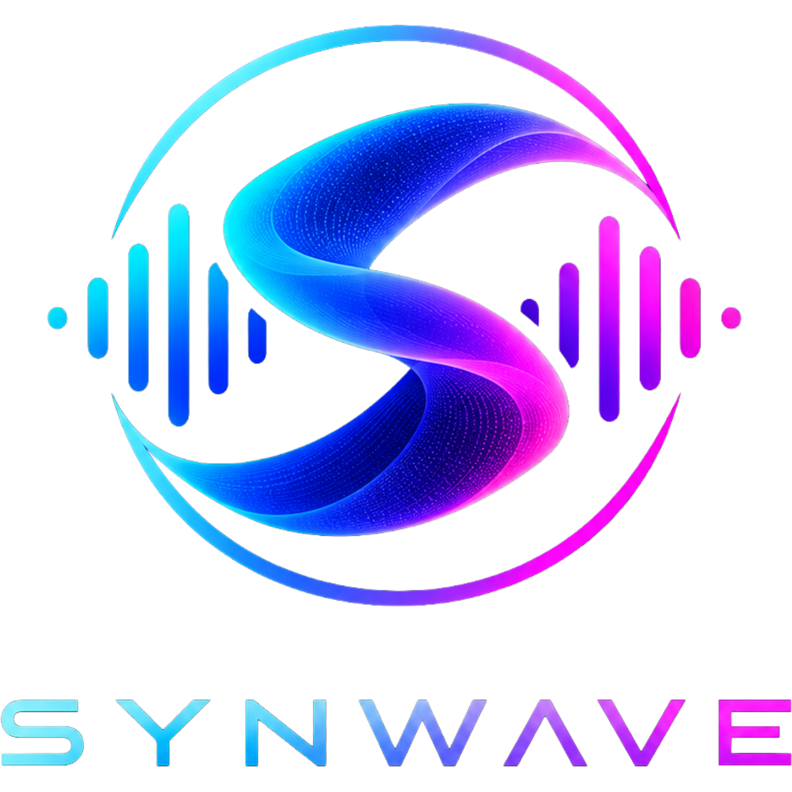
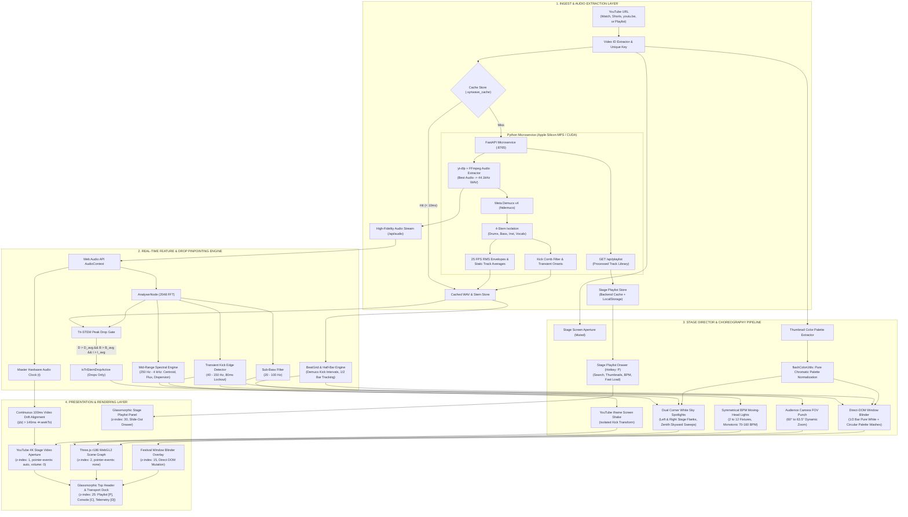

<div align="center">

  

  # SYNWAVE

  **Autonomous Procedural 3D Concert Stage Simulator & Neural Music Visualizer**

  [](LICENSE)
  [](https://vitejs.dev/)
  [](https://react.dev/)
  [](https://threejs.org/)
  [](https://pytorch.org/)
  [](https://www.typescriptlang.org/)
  [](https://fastapi.tiangolo.com/)

  <p align="center">
    A stadium-scale music festival concert simulator that orchestrates real-time, procedural 3D audiovisual performances. Powered by direct YouTube link ingest, high-fidelity audio extraction via <code>yt-dlp</code> and <code>ffmpeg</code>, Meta Demucs v4 neural 4-stem source separation on Apple Silicon Metal Performance Shaders (MPS), synchronized stage video playback, and intelligent concert lighting choreography.
  </p>

</div>

---

## 🎬 Live Demo Preview

https://github.com/user-attachments/assets/c813d12a-8a76-4ba4-ac8e-d8f42dc462b0

> [!NOTE]
> ### 🎵 Music & Visual Attribution
> **Audio & Visual Demo Showcase:**  
> - **Song & Music Video:** [Abandoned - Destroyer Of Worlds (Oppenheimer Remix) [Music Video]](https://www.youtube.com/@AbandonedOfficial)  
> - **Creator / Channel:** [Abandoned (@AbandonedOfficial)](https://www.youtube.com/@AbandonedOfficial)  
> - *Full music and visual credit to **Abandoned** for the audio composition and official music video featured in this demonstration.*

---

> [!IMPORTANT]
> ### 💬 Note to Potential Contributors & Community
> **Synwave is an evolving open-source project, and I know it still has bugs and areas that need improvement. Contributions, bug reports, suggestions, and pull requests are very welcome. Help me fix the existing issues and turn Synwave into a polished, reliable product!**

---

## 📑 Table of Contents

- [🎬 Live Demo Preview](#-live-demo-preview)
- [🌟 Project Overview](#-project-overview)
- [🏗️ Architectural Block Diagram](#️-architectural-block-diagram)
  - [System Flow Diagram (Mermaid)](#system-flow-diagram-mermaid)
  - [Functional Block Topology (ASCII)](#functional-block-topology-ascii)
  - [Deep Architectural Walkthrough](#deep-architectural-walkthrough)
- [✨ Key Features](#-key-features)
- [⌨️ Controls & Keyboard Shortcuts](#-controls--keyboard-shortcuts)
- [🚀 Installation & Development Setup](#-installation--development-setup)
- [🛠️ Technologies & Official Repositories](#️-technologies--official-repositories)
- [📜 Third-Party Libraries, Licenses & Attribution](#-third-party-libraries-licenses--attribution)
- [🐛 Known Issues & Roadmap](#-known-issues--roadmap)
- [🤝 How to Contribute](#-how-to-contribute)
- [📄 License](#-license)

---

## 🌟 Project Overview

**Synwave** transforms any YouTube link into a stadium-scale **procedural concert experience**. Rather than drawing simple 2D FFT spectrogram bars or unanchored wandering particles, Synwave acts as an **autonomous concert lighting designer and stage director**.

It places the user in the **front-row audience** facing a colossal festival stage modeled after real-world arena spectacles (Ultra Music Festival, Tomorrowland, EDC).

When a YouTube link is submitted, Synwave executes an acoustic intelligence pipeline:
1. **Direct YouTube Stage Video Mounting:** Loads and displays the YouTube video on the stage aperture screen with audio muted (`volume = 0`).
2. **High-Fidelity Audio Extraction (`yt-dlp` & `ffmpeg`):** Downloads and converts the uncompressed high-fidelity audio stream to WAV on the local microservice.
3. **Neural Source Separation (Meta Demucs v4):** Isolates the audio into 4 discrete acoustic stems (`drums`, `bass`, `instruments`, `vocals`) accelerated by Apple Silicon MPS hardware.
4. **Tri-STEM Peak Drop Pinpointing:** Identifies the precise climactic segments where drums, bass, and instruments simultaneously exceed their track averages.
5. **Procedural 3D Stage Choreography:** Directs moving-head spotlights, dual corner sky-reaching white searchlights, a 360° perimeter bass rig, camera sub-bass FOV zooms, and vertical-sync full-window blinder washes.
6. **Sub-10ms Persistent Cache:** Stores extracted audio and separated stem envelopes under `.synwave_cache` keyed uniquely by the YouTube link.

---

## 🏗️ Architectural Block Diagram

Synwave is structured into a four-tier decoupled architecture separating acoustic intelligence, real-time audio analysis, stage choreography, and hardware-accelerated presentation.

### System Flow Diagram (Mermaid)



---

### Functional Block Topology (ASCII)

```
====================================================================================================
                                      SYNWAVE SYSTEM TOPOLOGY
====================================================================================================

 [ YouTube URL / Stage Playlist ] ──► [ Video ID & Cache Resolver ]
                                             │
               ┌─────────────────────────────┴────────────────────────────┐
               ▼ (Cache Hit < 10ms)                                       ▼ (Cache Miss)
    [ Persistent Cache Store ]                                  [ FastAPI Daemon (:8765) ]
    • Tier 1: In-Memory Map                                     • Direct Audio Stream via yt-dlp & FFmpeg
    • Tier 2: Browser LocalStorage                              • Meta Demucs v4 (htdemucs on MPS)
    • Tier 3: Local Disk (.synwave_cache)                       • Static Averages (D_avg, B_avg, I_avg)
    • Tier 4: GET /api/playlist                                 • Kick Onsets & Comb Filtering
               │                                                          │
               └─────────────────────────────┬────────────────────────────┘
                                             │
                                             ▼
                            [ Real-Time Audio Engine ]
                            • Web Audio API Master Clock (t)
                            • 2048-Point FFT Spectral Decomp
                            • Tri-STEM Peak Drop Activation:
                              (D > D_avg) ∧ (B > B_avg) ∧ (I > I_avg) ∧ (Joint ≥ Thresh)
                                             │
        ┌────────────────────────────────────┼────────────────────────────────────┐
        ▼                                    ▼                                    ▼
 [ Sub-Bass (20-100Hz) ]          [ Kick Transient (40-150Hz) ]        [ Mid-Range Spectral (250Hz-4kHz) ]
   FOV Camera Punch (60°-63.5°)     Screen Shake & Blinder Trigger       White Sky Searchlights & Moving Heads
        │                                    │                                    │
        └────────────────────────────────────┼────────────────────────────────────┘
                                             │
                                             ▼
                            [ Show Director & Visual Engine ]
                            • Dual Corner White Sky Searchlights (Upward Zenith Projection)
                            • Symmetrical BPM-Synchronized Moving Heads (2-12)
                            • 12x 360° Continuous Rotatable Perimeter Bass Lights
                            • Full-Window Blinder Wash (1/2 Bar White Anchor + Pure Palette Colors)
                            • Stage Playlist Drawer (Instant One-Click Concert Loading)
                                             │
       ┌─────────────────────────────────────┴────────────────────────────────────┐
       ▼                                                                          ▼
[ Three.js r186 Scene Graph ]                                  [ YouTube 4K Stage Screen ]
• Transparent WebGL2 Canvas (z: 2)                             • 16:9 Stage Aperture (z: 1)
• 45m Skyward White Beams (Left, Zenith, Right)                • Muted Video Playback (vol: 0)
• Stage Truss & Jumbotron Bezels                               • Master Clock Continuous Sync Loop
• Stage Playlist Drawer (z: 30)                                • Zero Synwave Text Overlays
====================================================================================================
```

---

### Deep Architectural Walkthrough

#### 1. Acoustic Intelligence & Multi-Tier Caching Layer
- **Direct YouTube URL Audio Ingestion:** Provide any YouTube URL (or select from the persistent playlist). The Python microservice automatically downloads and extracts the uncompressed high-fidelity audio stream to WAV via `yt-dlp` and `ffmpeg` without requiring any external API keys or credentials.
- **Meta Demucs v4 HTDemucs (`demucs_service.py`):** Isolates local audio into four discrete high-fidelity stems: `drums`, `bass`, `instruments`, and `vocals`. Running on Apple Silicon Metal Performance Shaders (MPS) or NVIDIA CUDA, it computes 25 FPS normalized RMS envelopes, static track-wide averages ($\bar{A}_D, \bar{A}_B, \bar{A}_I$), and transient kick onsets.
- **Persistent Multi-Tier Stem Cache (`.synwave_cache/`):**
  - **In-Memory & IndexedDB:** Instant zero-latency lookups for active session tracks.
  - **Local Disk Cache:** Pre-processed WAV audio (`.synwave_cache/audio/yt_*.wav`), neural stem JSON envelopes (`.synwave_cache/stems/`), and metadata (`.synwave_cache/metadata/`). Pre-analyzed tracks achieve a `< 20ms` sub-millisecond cache hit, loading instantaneously.
  - **Stage Playlist Ingestion API (`/api/playlist`):** Automatically aggregates all processed tracks, their YouTube video IDs, durations, extracted thumbnails, Demucs neural stem readiness, and BPMs into a single responsive library.

#### 2. Real-Time Feature & Drop Pinpointing Engine
- **Pinpointed Tri-STEM Peak Drop Gate (`AudioEngine.ts`):** Climactic visuals and drop sweeps are gated strictly by the song's true drop segment. A frame qualifies as a drop if and only if:
  $$D(t) > \bar{A}_D \;\land\; B(t) > \bar{A}_B \;\land\; I(t) > \bar{A}_I \;\land\; J(t) \ge \text{Threshold}$$
  This mathematical gate completely eliminates false activations during vocal buildups, quiet intros, and acoustic breakdowns.
- **Isolated Sub-Bass Bandpass ($20-100\text{Hz}$):** Directly drives camera FOV zoom punch ($60^\circ \to 63.5^\circ$), physically vibrating the audience perspective without harmonic distortion from vocals or guitars.
- **Transient Kick Detection ($40-150\text{Hz}$):** Comb-filtered kick detector fusing Demucs neural kick transients with FFT kick spikes across an 80ms refractory lockout, driving 2D pixel displacement strictly on the YouTube stage screen element.
- **Mid-Range Spectral Engine ($250\text{Hz}-4\text{kHz}$):** Computes mid-range spectral centroid ($C_{\text{mid}}$), spectral flux ($F_{\text{mid}}$), and dispersion ($D_{\text{mid}}$) fused with Demucs instrumental data to steer intelligent concert spotlight choreographies without bass interference.

#### 3. Stage Director & Visual Choreography Pipeline
- **Dual Corner White Sky Spotlights (`StageLightsEffect.ts`):**
  - Two high-power concert searchlights mounted at the lower left and lower right corners of the YouTube iframe stage aperture.
  - **Fixed Origins (Zero Audio Shake):** The spotlight chassis (`fixedBaseMesh`) and optical head origins (`headGroup`) are strictly fixed in 3D stage space with zero translation or audio shake.
  - **Bass-Presence Turn On:** Automatically turns ON when bass is present in the track (`effectiveBass > 0.08`) with musical attack/decay envelopes, and turns completely OFF during bass-free passages.
  - **Kick-Synchronized Blinking:** Blinks in tight lockstep with drum kick hits (`features.isKick` / kick stem spikes), executing a concert blink cycle (impact strike flash $\to$ shutter cut notch $\to$ smooth recovery).
  - **Dynamic Beam Sky Movement:** Uses the same tempo/instrumental agility logic as colouring moving heads (`sweepSpeed = (0.8 + instStem * 1.4) * verifiedTempoSpeed`), projecting 45-meter volumetric white beams into the sky. Sweeps are strictly constrained to Left, Top (sky zenith), and Right — never downward. Engages rapid crossing scissor sweeps during drops.
- **12x 360° Continuous Rotatable Perimeter Bass Lights:**
  - High-intensity moving heads framing the perimeter of the YouTube screen, driven continuously by bass stem energy and sub-bass frequencies.
- **Symmetrical BPM Spotlights (`StageLightsEffect.ts`):** Symmetrically frames the YouTube screen across Top, Left, and Right fixtures, scaling dynamically from 2 to 12 fixtures based on detected BPM ($70-160\text{ BPM}$).
- **Kick-Activated Screen Flash Blinder (`flashColorUtils.ts` & `VisualEngine.ts`):**
  - **Pure Color Gradient Isolation:** Full-window radial blinder wash ($100\text{vw} \times 100\text{vh}$ at `z-index: 15`). White frames flash pure brilliant white; colored frames flash 100% pure RGB values from the song palette without central white core washout.
  - **1/2 Bar Pure White Anchor Rule:** Every 1/2 bar downbeat kick (every 2 beats in 4/4 meter) is guaranteed to flash pure white (`#ffffff`), anchoring the rhythmic structure.
  - **Circular Palette Color Rotation:** Additional kicks occurring within the same 1/2 bar cycle through the extracted song palette one after another in a continuous circular sequence.
  - **Zero Dropped Kicks:** Evaluated with an 80ms refractory interval that supports ultra-fast drum rolls up to 750 BPM with no minimum volume dropouts.

#### 4. Presentation & Hardware-Accelerated Rendering Layer
- **Three.js r186 WebGL2 Canvas (`z-index: 2`):** Transparent canvas overlaying the stage video with additive volumetric lighting, stage trusses, moving heads, and atmosphere dust.
- **Synchronized 1K YouTube Stage Aperture (`z-index: 1`):**
  - Muted video playback (`volume = 0`) complying with browser autoplay policies while local lossless audio serves as the master clock.
  - Continuous 100ms drift monitor: if video drifts $> 140\text{ms}$ from master audio, micro-seeks snap the playhead back into phase.
  - **Highest Resolution till 1K (`hd1080` / `hd720`):** Enforces 1080p Full HD video playback via `vq: 'hd1080'` and proactive quality negotiations on buffer and playback starts, capping out $> 1\text{K}$ streams to preserve 60 FPS stage performance.
  - **Centered 16:9 Caption-Masking Crop:** Scaled uniformly at $1.40\times$ from the center within an `overflow: hidden` aperture. Eliminates bottom closed captions, roll-up auto-subtitles, and player watermarks while maintaining a non-distorted, standard 16:9 aspect ratio without over-cropping the concert performance.
  - Clean video aperture: zero Synwave-generated text overlays, badges, or titles over the video; captions disabled by default (`cc_load_policy: 0`, `controls: 0`).
- **Responsive Glassmorphic HUD & Stage Playlist Drawer (`z-index: 25` & `z-index: 30`):**
  - **Stage Playlist Drawer (`P`):** Slide-out drawer with real-time title/artist search, 16:9 YouTube thumbnail previews, 3-bar animated soundwave equalizer for active tracks, `STEMS READY` / `BPM` badges, and instant single-click song loading.
  - **Audio-to-Visual Routing Console (`C`):** Full calibration of sensitivity, blinder intensity, and photosensitive safety mode.
  - **Real-Time Telemetry HUD (`D`):** Live FFT, neural stem meters, BPM confidence, and MPS hardware diagnostics.

---

## ✨ Key Features

- **Stage Playlist Drawer & Instant Concert Loading:**
  Access your library of processed songs with the top-right `ListMusic` button or the `P` hotkey. Search by track title or artist, preview 16:9 thumbnails, and load any cached song into Synwave with sub-20ms instant startup.
- **High-Definition 1K Stage Video Playback:**
  The YouTube iframe player automatically locks playback to the highest resolution up to 1K (`hd1080` Full HD / `hd720` HD), while strictly capping out resolutions > 1K (1440p/4K) to safeguard GPU resources and maintain fluid 60 FPS performance. Explicit 100% viewport attributes and quality range constraints guarantee maximum visual sharpness without letterboxing.
- **Strict Thumbnail-Derived Screen Flash Palette:**
  Screen flashes strictly follow the authentic color palette extracted from the official video thumbnail (e.g. 2–3 authentic shades of blue for blue-dominant music videos) plus pure white (`#ffffff`) for the 1/2-bar impact anchor. Dominant hue clustering with a 6% chromatic volume threshold filters out small logos or compression artifacts, ensuring zero synthetic green, red, or violet colors bleed into the performance. Monochromatic videos strictly default to pure white.
- **Dual Corner White Sky Spotlights (Skyward Searchlights):**
  Two dedicated concert spotlights mounted near the left and right corners of the YouTube iframe screen with strictly fixed origins (zero audio shake). Features dynamic beam sweeps across Left, Top (zenith), and Right using colouring spotlight logic (never downward), automated bass-presence illumination, and tight kick/drum hit synchronized blinking.
- **360° Continuous Perimeter Bass Rig:**
  12 perimeter moving heads directly modulated by neural bass stems executing continuous 360° sweeps around the stage aperture.
- **Pinpointed Tri-STEM Peak Drop Activation:**
  Climactic visuals activate exclusively during true musical drops where Drums, Bass, and Instruments simultaneously exceed track averages, staying cleanly off during intros, verses, and breakdowns.
- **Direct YouTube Link Stage Ingest:**
  Provide any YouTube URL (via input pill, paste button, or `Cmd+V`). Synwave directly mounts the video on the concert screen while extracting lossless audio.
- **High-Precision Audio-Video Drift Synchronization:**
  A 100ms continuous monitoring loop locks the YouTube stage video to the master Web Audio clock, snapping buffered video into lip-sync and percussive phase.
- **Sub-10ms Persistent STEM Cache:**
  Subsequent plays of analyzed songs load in **`< 10ms`** from local disk under `.synwave_cache`, eliminating redundant neural compute.
- **Zero API Key Requirement:**
  Operates 100% locally with `yt-dlp`, `ffmpeg`, YouTube oEmbed, and Demucs v4. No Google Cloud API keys, `.env` files, quotas, or rate-limiting apply.
- **Clean Stage Video Aperture & 16:9 Centered Caption Crop:**
  The YouTube concert screen is completely free of text overlays or badges. The iframe is scaled $1.40\times$ from the center within a standard 16:9 aperture, completely cropping out bottom subtitles/captions and watermarks without over-cropping the performance.
- **Dual-Layer Audio Impact:**
  Deep sub-bass ($20-100\text{Hz}$) drives camera FOV zoom punch ($60^\circ \to 63.5^\circ$), while percussive kicks shake the YouTube stage screen in 2D space.
- **Symmetrical BPM-Scaled Moving Heads:**
  Moving-head spotlights scale dynamically from 2 to 12 fixtures framing the screen based on verified track tempo.
- **Freeze-on-Pause Engine:**
  Pausing playback instantly halts visual time accumulators (`deltaSeconds = 0`). Moving heads, perimeter lights, and white sky spotlights freeze in place without snapping.
- **Interactive Routing Console & Telemetry HUD:**
  Press `C` for real-time calibration of shake, blinders, decay, and photosensitive safety mode. Press `D` for live FFT, stem energy, and MPS hardware telemetry.

---

## ⌨️ Controls & Keyboard Shortcuts

| Key / Shortcut | Action | Description |
|---|---|---|
| `Space` | **Play / Pause** | Toggle playback (with input focus protection and iframe focus recovery). |
| `P` | **Stage Playlist Drawer** | Open or close the persistent stage playlist drawer with search and one-click loading. |
| `F` | **Toggle Fullscreen** | Enter or exit native edge-to-edge fullscreen mode. |
| `Double-Click` | **Toggle Fullscreen** | Double-clicking anywhere on the 3D stage toggles fullscreen. |
| `C` | **Routing Console** | Open or close the Audio-to-Visual Routing Console. |
| `D` | **Telemetry HUD** | Toggle the Real-Time Synchronization & Diagnostics Overlay. |
| `M` | **Reduced Flash Mode** | Toggle photosensitive safety blinder strobe reduction. |
| `Arrow Left` | **Seek -5 Seconds** | Scrub playback backward by 5 seconds. |
| `Arrow Right` | **Seek +5 Seconds** | Scrub playback forward by 5 seconds. |
| `Digit 1` | **Festival Profile** | Re-engage the Festival Mainstage choreography profile. |
| `Escape` | **Dismiss Panels** | Close the Stage Playlist Drawer, Routing Console, or Telemetry HUD. |

---

## 🚀 Installation & Development Setup

### Prerequisites

Ensure you have the following installed on your machine:
- **Node.js**: v18.0.0 or later (v20+ recommended)
- **npm**: v9.0.0 or later
- **Python**: v3.10, v3.11, or v3.12 (with `venv` support)
- **ffmpeg**: Required for audio extraction (`brew install ffmpeg` on macOS)
- **macOS / Linux / Windows**:
  - *macOS (Apple Silicon M1/M2/M3/M4)*: Supported with native Metal Performance Shaders (MPS) hardware acceleration.
  - *Windows / Linux*: Supported with NVIDIA CUDA or CPU fallback.

---

### Step 1: Clone the Repository

```bash
git clone https://github.com/K-692/Synwave.git
cd Synwave
```

---

### Step 2: Install Frontend Dependencies

```bash
npm install
```

---

### Step 3: Set Up Python Microservice Virtual Environment

Synwave uses a local FastAPI microservice for `yt-dlp` audio extraction and Meta Demucs neural stem separation.

```bash
# 1. Create a dedicated Python virtual environment
python3 -m venv .venv

# 2. Activate the virtual environment
# On macOS / Linux:
source .venv/bin/activate
# On Windows (cmd.exe):
# .venv\Scripts\activate.bat
# On Windows (PowerShell):
# .venv\Scripts\Activate.ps1

# 3. Upgrade pip and install required dependencies
pip install --upgrade pip
pip install -r requirements.txt
```

---

### Step 4: Start the Development Servers

#### Option A: Unified Launcher (Recommended — Single Command)

Run the unified startup script that launches both the Python audio intelligence microservice and the Vite frontend dev server with one command and automatic graceful shutdown (`Ctrl+C`):

```bash
# Using the executable shell script
./start.sh

# Or via npm
npm start
# (or npm run dev)
```

- **Frontend:** `http://localhost:5173`
- **Python Audio Microservice:** `http://127.0.0.1:8765`

Open **`http://localhost:5173`** in your browser.

---

#### Option B: Separate Terminal Windows (Manual Alternative)

If you prefer running services in separate terminals:

**Terminal 1 — Python Microservice:**
```bash
source .venv/bin/activate
python3 server.py
```
*Microservice starts on `http://127.0.0.1:8765`.*

**Terminal 2 — Vite Frontend Server:**
```bash
npm run dev:frontend
```
*Frontend starts on `http://localhost:5173`.*

---

### Step 6: Verify Build & Code Correctness

To check TypeScript types and build the production bundle:
```bash
npm run build
```

To run the fast linter:
```bash
npm run lint
```

---

---

## 🛠️ Technologies & Official Repositories

| Technology | Role in Synwave | Official Repository / Website |
|---|---|---|
| **React 19** | Modern UI components, hooks, reactive state management | [facebook/react](https://github.com/facebook/react) |
| **Three.js (r186)** | 3D scene graph, procedural geometry, lighting shaders, WebGL2 | [mrdoob/three.js](https://github.com/mrdoob/three.js) |
| **yt-dlp** | High-speed audio extraction and stream resolution from YouTube URLs | [yt-dlp/yt-dlp](https://github.com/yt-dlp/yt-dlp) |
| **FFmpeg** | High-fidelity audio stream decoding and conversion to uncompressed WAV | [FFmpeg/FFmpeg](https://ffmpeg.org/) |
| **Meta Demucs v4** | Neural music source separation (Hybrid Transformer HTDemucs) | [adefossez/demucs](https://github.com/adefossez/demucs) |
| **PyTorch** | Deep learning runtime with Apple Silicon MPS acceleration | [pytorch/pytorch](https://github.com/pytorch/pytorch) |
| **FastAPI** | High-performance Python microservice handling audio extraction and AI tasks | [fastapi/fastapi](https://github.com/fastapi/fastapi) |
| **Uvicorn** | Lightning-fast ASGI web server implementation | [encode/uvicorn](https://github.com/encode/uvicorn) |
| **TypeScript** | Type safety, rigorous interfaces, and compile-time correctness | [microsoft/TypeScript](https://github.com/microsoft/TypeScript) |
| **Vite** | Next-generation frontend tooling and HMR dev server | [vitejs/vite](https://github.com/vitejs/vite) |
| **Lucide Icons** | Minimalist modern icon set for controls and navigation | [lucide-icons/lucide](https://github.com/lucide-icons/lucide) |
| **Web Audio API** | Hardware-synchronized audio clock, multi-band FFT analyser | [W3C Web Audio API Spec](https://www.w3.org/TR/webaudio/) |

---

## 📜 Third-Party Libraries, Licenses & Attribution

All third-party libraries incorporated into Synwave are free and open-source software. We gratefully acknowledge and credit the original authors and maintainers:

### Frontend Dependencies

| Library | Version | License | Authors / Maintainers | Repository Link |
|---|---|---|---|---|
| `react` | `^19.2.8` | [MIT](https://github.com/facebook/react/blob/main/LICENSE) | Meta Platforms, Inc. & React Contributors | [facebook/react](https://github.com/facebook/react) |
| `react-dom` | `^19.2.8` | [MIT](https://github.com/facebook/react/blob/main/LICENSE) | Meta Platforms, Inc. & React Contributors | [facebook/react](https://github.com/facebook/react) |
| `three` | `^0.186.1` | [MIT](https://github.com/mrdoob/three.js/blob/dev/LICENSE) | Ricardo Cabello (Mr.doob) & Three.js Authors | [mrdoob/three.js](https://github.com/mrdoob/three.js) |
| `@types/three` | `^0.186.0` | [MIT](https://github.com/DefinitelyTyped/DefinitelyTyped/blob/master/LICENSE) | DefinitelyTyped Contributors | [DefinitelyTyped](https://github.com/DefinitelyTyped/DefinitelyTyped) |
| `lucide-react` | `^1.59.0` | [ISC](https://github.com/lucide-icons/lucide/blob/main/LICENSE) | Lucide Contributors & Feather Icons Authors | [lucide-icons/lucide](https://github.com/lucide-icons/lucide) |
| `vite` | `^8.3.0` | [MIT](https://github.com/vitejs/vite/blob/main/LICENSE) | Evan You & Vite Contributors | [vitejs/vite](https://github.com/vitejs/vite) |
| `@vitejs/plugin-react` | `^6.1.1` | [MIT](https://github.com/vitejs/vite-plugin-react/blob/main/LICENSE) | Vite Contributors | [vite-plugin-react](https://github.com/vitejs/vite-plugin-react) |
| `typescript` | `~6.0.2` | [Apache-2.0](https://github.com/microsoft/TypeScript/blob/main/LICENSE.txt) | Microsoft Corporation | [microsoft/TypeScript](https://github.com/microsoft/TypeScript) |
| `oxlint` | `^1.81.0` | [MIT](https://github.com/oxc-project/oxc/blob/main/LICENSE) | Boshen & Oxc Project Contributors | [oxc-project/oxc](https://github.com/oxc-project/oxc) |

### Python Microservice Dependencies

| Package | Version | License | Authors / Maintainers | Repository Link |
|---|---|---|---|---|
| `demucs` | `^4.0.1` | [MIT](https://github.com/adefossez/demucs/blob/main/LICENSE) | Alexandre Défossez (Meta AI Research) | [adefossez/demucs](https://github.com/adefossez/demucs) |
| `torch` | `^2.2.0` | [BSD-3-Clause](https://github.com/pytorch/pytorch/blob/main/LICENSE) | Meta Platforms, Inc. & PyTorch Contributors | [pytorch/pytorch](https://github.com/pytorch/pytorch) |
| `yt-dlp` | `^2024.0.0` | [Unlicense](https://github.com/yt-dlp/yt-dlp/blob/master/LICENSE) | yt-dlp Contributors | [yt-dlp/yt-dlp](https://github.com/yt-dlp/yt-dlp) |
| `fastapi` | `^0.115.0` | [MIT](https://github.com/fastapi/fastapi/blob/master/LICENSE) | Sebastián Ramírez (tiangolo) | [fastapi/fastapi](https://github.com/fastapi/fastapi) |
| `uvicorn` | `^0.30.0` | [BSD-3-Clause](https://github.com/encode/uvicorn/blob/master/LICENSE.md) | Encode & Uvicorn Contributors | [encode/uvicorn](https://github.com/encode/uvicorn) |
| `numpy` | `^1.26.0` | [BSD-3-Clause](https://github.com/numpy/numpy/blob/main/LICENSE.txt) | Travis Oliphant & NumPy Developers | [numpy/numpy](https://github.com/numpy/numpy) |
| `aiofiles` | `^23.2.0` | [Apache-2.0](https://github.com/Tinche/aiofiles/blob/master/LICENSE) | Tin Tvrtković & aiofiles Contributors | [Tinche/aiofiles](https://github.com/Tinche/aiofiles) |
| `python-multipart` | `^0.0.12` | [Apache-2.0](https://github.com/Kludex/python-multipart/blob/master/LICENSE.txt) | Andrew Chen Wang & Kludex | [Kludex/python-multipart](https://github.com/Kludex/python-multipart) |

### 🎬 Demonstration Media & Audio Attribution

| Asset / File | Title & Description | Creator / Channel | Attribution & Links |
|---|---|---|---|
| [`demo/demo.mp4`](demo/demo.mp4) | **Destroyer Of Worlds (Oppenheimer Remix)** [Music Video] | [Abandoned](https://www.youtube.com/@AbandonedOfficial) | Official YouTube Channel: [@AbandonedOfficial](https://www.youtube.com/@AbandonedOfficial)<br>Music composition and official music video rights belong to Abandoned. Used with credit for non-commercial open-source visualization demonstration. |

---

## 🐛 Known Issues & Roadmap

Here are the currently known bugs and areas under active improvement:

1. **First-Run Demucs Weights Download Latency:**
   On the very first track analyzed, Demucs downloads the `htdemucs` neural weights (~80MB) from GitHub releases. This may take 20–45 seconds depending on network bandwidth. Subsequent tracks with the same model run much faster, and cached songs load in `< 10ms`.
2. **YouTube Video Embed Restrictions:**
   Certain record labels disable third-party iframe embeds for select official music videos on YouTube (resulting in error `150` or `101`). When this occurs, Synwave maintains local audio playback and procedural 3D stage effects while logging a descriptive fallback notice.
3. **WebGL Context Loss on Display Sleep:**
   On some operating systems, waking a machine from deep sleep or switching external display adapters can trigger a WebGL context loss. Reloading the page restores normal operation.
4. **Multi-Window High-DPI Canvas Resizing:**
   Dragging the browser window across displays with different device pixel ratios (e.g., Retina Mac to standard 1080p monitor) occasionally requires a canvas refresh.

---

## 🤝 How to Contribute

Contributions are what make the open-source community such an amazing place to learn, inspire, and create. Any contributions you make are **greatly appreciated**.

### Contribution Workflow

1. **Fork the Project:**
   Click the **Fork** button on the top right of the [Synwave Repository](https://github.com/K-692/Synwave).
2. **Create your Feature Branch:**
   ```bash
   git checkout -b feature/AmazingChoreography
   ```
3. **Set Up Development Environment:**
   Follow the [Installation & Development Setup](#-installation--development-setup) guide above.
4. **Commit your Changes:**
   ```bash
   git commit -m 'feat: add moving-head gobos to stage lights'
   ```
5. **Verify Types and Build:**
   ```bash
   npm run build
   npm run lint
   ```
   *Make sure `npm run build` exits with code 0 before submitting.*
6. **Push to the Branch:**
   ```bash
   git push origin feature/AmazingChoreography
   ```
7. **Open a Pull Request:**
   Submit your pull request detailing the changes made, screenshots/recordings of visual modifications, and any testing performed.

### Coding Guidelines
- **Modularity:** Keep 3D visual effects isolated in `src/visualizer/effects/` and audio processors in `src/audio/`.
- **Comments & Cleanliness:** Add clear comments explaining non-trivial trigonometric sweeps or shader parameters.
- **WebGL Hygiene:** Always dispose of unused geometries, materials, and textures when destroying or reloading visual effects to avoid GPU memory leaks.
- **Security:** Never commit real API keys, credentials, or personal audio files to git.

---

## 📄 License

Distributed under the **MIT License**. See [`LICENSE`](LICENSE) for full legal text.

---

<div align="center">
  <sub>Built with ❤️ for concertgoers, electronic music producers, and 3D visual artists.</sub>
</div>
